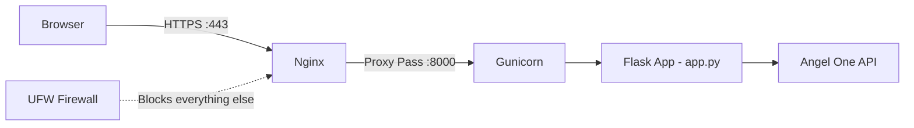

# 🚀 Deploying Thunder Trading to DigitalOcean — Secure Production Guide

This guide walks you through securely hosting your Flask trading app on a DigitalOcean droplet with **Nginx + Gunicorn + SSL + Firewall**.

---

## Architecture Overview



> [!IMPORTANT]
> Your app handles **real trading credentials and live orders**. Security is critical — never skip the SSL or firewall steps.

---

## Table of Contents

1. [Create the Droplet](#1-create-the-droplet)
2. [Initial Server Setup & SSH Hardening](#2-initial-server-setup--ssh-hardening)
3. [Install Dependencies](#3-install-dependencies)
4. [Deploy Your Code](#4-deploy-your-code)
5. [Configure Gunicorn (WSGI Server)](#5-configure-gunicorn-wsgi-server)
6. [Configure Nginx (Reverse Proxy)](#6-configure-nginx-reverse-proxy)
7. [Enable SSL with Let's Encrypt](#7-enable-ssl-with-lets-encrypt)
8. [Configure Firewall (UFW)](#8-configure-firewall-ufw)
9. [Set Up systemd Service](#9-set-up-systemd-service)
10. [Environment Variable Security](#10-environment-variable-security)
11. [Monitoring & Logs](#11-monitoring--logs)
12. [Updating Your App](#12-updating-your-app)
13. [Security Checklist](#13-security-checklist)

---

## 1. Create the Droplet

1. Go to [cloud.digitalocean.com](https://cloud.digitalocean.com) → **Create** → **Droplets**
2. Choose the following settings:

| Setting | Recommended Value |
|---------|------------------|
| **Image** | Ubuntu 24.04 LTS |
| **Plan** | Basic — $6/mo (1 vCPU, 1 GB RAM, 25 GB SSD) |
| **Region** | **Bangalore (BLR1)** — closest to NSE/BSE servers |
| **Authentication** | **SSH Key** (strongly recommended over password) |
| **Hostname** | `thunder-trading` |

> [!TIP]
> Choose the **Bangalore** region for lowest latency to Angel One's API servers. The $6/mo plan is sufficient for a single-user trading bot.

### Generate SSH Key (if you don't have one)

On your Mac, run:
```bash
ssh-keygen -t ed25519 -C "het@thunder-trading"
```
- Press Enter to accept default path (`~/.ssh/id_ed25519`)
- Set a passphrase (recommended)
- Copy the public key: `cat ~/.ssh/id_ed25519.pub`
- Paste it into DigitalOcean's SSH key field

---

## 2. Initial Server Setup & SSH Hardening

### 2.1 Connect to the Droplet

```bash
ssh root@YOUR_DROPLET_IP
```

### 2.2 Create a Non-Root User

> [!CAUTION]
> Never run your app as `root`. Always use a dedicated user.

```bash
# Create user
adduser thunder

# Add to sudo group
usermod -aG sudo thunder

# Copy SSH keys to new user
rsync --archive --chown=thunder:thunder ~/.ssh /home/thunder
```

### 2.3 Harden SSH

Edit the SSH config:
```bash
nano /etc/ssh/sshd_config
```

Make these changes:
```
Port 2222                          # Change from default 22
PermitRootLogin no                 # Disable root login
PasswordAuthentication no          # SSH key only
MaxAuthTries 3                     # Limit login attempts
AllowUsers thunder                 # Only allow your user
```

Restart SSH:
```bash
systemctl restart sshd
```

> [!WARNING]
> Before closing your current SSH session, open a **new terminal** and test you can connect with the new settings:
> ```bash
> ssh -p 2222 thunder@YOUR_DROPLET_IP
> ```
> If it fails, you still have your original session to fix things.

From now on, all commands are run as the `thunder` user.

---

## 3. Install Dependencies

```bash
# Update system packages
sudo apt update && sudo apt upgrade -y

# Install Python 3, pip, venv and build tools
sudo apt install -y python3 python3-pip python3-venv python3-dev \
    build-essential libffi-dev nginx certbot python3-certbot-nginx git

# Verify installations
python3 --version
nginx -v
```

---

## 4. Deploy Your Code

### 4.1 Push Code to Git (from your Mac)

Make sure your `.gitignore` excludes sensitive files (it already does — `.env`, `venv/`, `__pycache__/`).

From your Mac:
```bash
cd "/Users/hetshah/Documents/codingProjects/ThunderBolts/Project Uno/seventeenthapril/thunder_trading"
git add -A
git commit -m "Prepare for production deployment"
git push origin main
```

### 4.2 Clone on the Droplet

```bash
# On the droplet as 'thunder' user
cd /home/thunder
git clone https://github.com/YOUR_USERNAME/thunder_trading.git
cd thunder_trading
```

### 4.3 Set Up Virtual Environment

```bash
python3 -m venv venv
source venv/bin/activate
pip install --upgrade pip
pip install -r requirements.txt
```

### 4.4 Create the `.env` File on the Server

> [!CAUTION]
> Never commit `.env` to Git. Create it directly on the server.

```bash
nano /home/thunder/thunder_trading/.env
```

Paste your credentials:
```env
ANGELONE_API_KEY="your_api_key"
ANGELONE_CLIENT_ID="H76493"
ANGELONE_PASSWORD="your_password"
ANGEL_CLIENT_ID="H76493"
ANGELONE_TOTP_SECRET="your_totp_secret"
ANGELONE_MPIN="your_mpin"
USERNAME="topgun"
PASSWORD="maverick"
SECRET_KEY="generate_a_strong_random_key_here"
```

Lock down permissions:
```bash
chmod 600 /home/thunder/thunder_trading/.env
chown thunder:thunder /home/thunder/thunder_trading/.env
```

> [!TIP]
> Generate a strong `SECRET_KEY` with:
> ```bash
> python3 -c "import secrets; print(secrets.token_hex(32))"
> ```

---

## 5. Configure Gunicorn (WSGI Server)

> [!IMPORTANT]
> Flask's built-in server (`flask run`) is **not safe for production**. Use Gunicorn.

### 5.1 Test Gunicorn Manually

```bash
cd /home/thunder/thunder_trading
source venv/bin/activate
cd api
gunicorn --bind 127.0.0.1:8000 --workers 1 --threads 4 --timeout 120 app:app
```

- **`--workers 1`**: Single worker because your app uses **global state** and **threading** for the trading bot. Multiple workers would create separate copies of your trading state.
- **`--threads 4`**: Allows concurrent requests within the single worker.
- **`--timeout 120`**: Extended timeout since Angel One API calls can be slow.

Press `Ctrl+C` to stop after confirming it works.

### 5.2 Create Gunicorn Config File

```bash
nano /home/thunder/thunder_trading/gunicorn.conf.py
```

```python
# Gunicorn configuration for Thunder Trading

# Binding
bind = "127.0.0.1:8000"

# Worker configuration
# IMPORTANT: Use 1 worker because the app uses global state for trading
workers = 1
threads = 4
worker_class = "gthread"

# Timeouts
timeout = 120
graceful_timeout = 30
keepalive = 5

# Logging
accesslog = "/home/thunder/thunder_trading/logs/gunicorn-access.log"
errorlog = "/home/thunder/thunder_trading/logs/gunicorn-error.log"
loglevel = "info"

# Process naming
proc_name = "thunder_trading"

# Security
limit_request_line = 4094
limit_request_fields = 100
limit_request_field_size = 8190
```

Create the logs directory:
```bash
mkdir -p /home/thunder/thunder_trading/logs
```

---

## 6. Configure Nginx (Reverse Proxy)

### 6.1 Create Nginx Site Config

```bash
sudo nano /etc/nginx/sites-available/thunder-trading
```

Paste the following (replace `YOUR_DOMAIN` with your actual domain, or use the droplet IP temporarily):

```nginx
server {
    listen 80;
    server_name YOUR_DOMAIN;  # e.g., trading.yourdomain.com

    # Security headers
    add_header X-Frame-Options "SAMEORIGIN" always;
    add_header X-Content-Type-Options "nosniff" always;
    add_header X-XSS-Protection "1; mode=block" always;
    add_header Referrer-Policy "strict-origin-when-cross-origin" always;
    add_header Content-Security-Policy "default-src 'self'; script-src 'self' 'unsafe-inline' 'unsafe-eval' https://cdn.plot.ly; style-src 'self' 'unsafe-inline'; img-src 'self' data:; connect-src 'self';" always;

    # Rate limiting zone (defined in nginx.conf http block)
    # limit_req zone=trading burst=20 nodelay;

    # Serve static files directly (faster than going through Gunicorn)
    location /static/ {
        alias /home/thunder/thunder_trading/static/;
        expires 1d;
        add_header Cache-Control "public, immutable";
    }

    # Favicon
    location /favicon.ico {
        alias /home/thunder/thunder_trading/static/favicon.ico;
        access_log off;
        expires 30d;
    }

    # Proxy everything else to Gunicorn
    location / {
        proxy_pass http://127.0.0.1:8000;
        proxy_set_header Host $host;
        proxy_set_header X-Real-IP $remote_addr;
        proxy_set_header X-Forwarded-For $proxy_add_x_forwarded_for;
        proxy_set_header X-Forwarded-Proto $scheme;

        # WebSocket support (if needed in future)
        proxy_http_version 1.1;
        proxy_set_header Upgrade $http_upgrade;
        proxy_set_header Connection "upgrade";

        # Timeouts for long-running trading operations
        proxy_read_timeout 120s;
        proxy_connect_timeout 10s;
        proxy_send_timeout 120s;
    }

    # Block common attack paths
    location ~ /\. {
        deny all;
        access_log off;
        log_not_found off;
    }

    # Block access to .env and other sensitive files
    location ~ /\.env {
        deny all;
        return 404;
    }
}
```

### 6.2 Enable the Site

```bash
# Enable the site
sudo ln -s /etc/nginx/sites-available/thunder-trading /etc/nginx/sites-enabled/

# Remove default site
sudo rm /etc/nginx/sites-enabled/default

# Test config
sudo nginx -t

# Reload Nginx
sudo systemctl reload nginx
```

### 6.3 Add Rate Limiting (Optional but Recommended)

Edit the main Nginx config:
```bash
sudo nano /etc/nginx/nginx.conf
```

Add inside the `http { }` block:
```nginx
# Rate limiting for trading API
limit_req_zone $binary_remote_addr zone=trading:10m rate=10r/s;
```

Then uncomment the `limit_req` line in your site config.

---

## 7. Enable SSL with Let's Encrypt

> [!IMPORTANT]
> You need a **domain name** pointed to your droplet's IP for SSL. If you don't have one, you can:
> 1. Buy a cheap domain (~$2/yr from Namecheap/Cloudflare)
> 2. Use a free subdomain from [freedns.afraid.org](https://freedns.afraid.org)
> 3. Point your domain's A record to your droplet IP

### 7.1 Get the Certificate

```bash
sudo certbot --nginx -d YOUR_DOMAIN
```

Follow the prompts:
- Enter your email
- Agree to terms
- Choose to redirect HTTP → HTTPS (option 2)

### 7.2 Auto-Renewal

Certbot sets up auto-renewal automatically. Verify:
```bash
sudo certbot renew --dry-run
```

> [!TIP]
> If you don't have a domain and just want to test, you can access the app via `http://YOUR_DROPLET_IP` temporarily. But **never trade with real money over plain HTTP** — your credentials would be sent in the clear.

---

## 8. Configure Firewall (UFW)

```bash
# Allow SSH on custom port
sudo ufw allow 2222/tcp comment 'SSH'

# Allow HTTP and HTTPS
sudo ufw allow 80/tcp comment 'HTTP'
sudo ufw allow 443/tcp comment 'HTTPS'

# Enable firewall
sudo ufw enable

# Verify rules
sudo ufw status verbose
```

Expected output:
```
Status: active

To                         Action      From
--                         ------      ----
2222/tcp                   ALLOW       Anywhere       # SSH
80/tcp                     ALLOW       Anywhere       # HTTP
443/tcp                    ALLOW       Anywhere       # HTTPS
```

> [!WARNING]
> Port `8000` (Gunicorn) is intentionally **NOT** exposed. It should only be accessible internally via Nginx.

---

## 9. Set Up systemd Service

This makes your app start automatically on boot and restart on crashes.

### 9.1 Create the Service File

```bash
sudo nano /etc/systemd/system/thunder-trading.service
```

```ini
[Unit]
Description=Thunder Trading Bot — Gunicorn Flask App
After=network.target
Wants=network-online.target

[Service]
Type=notify
User=thunder
Group=thunder
WorkingDirectory=/home/thunder/thunder_trading/api
Environment="PATH=/home/thunder/thunder_trading/venv/bin:/usr/local/bin:/usr/bin"
EnvironmentFile=/home/thunder/thunder_trading/.env
ExecStart=/home/thunder/thunder_trading/venv/bin/gunicorn \
    --config /home/thunder/thunder_trading/gunicorn.conf.py \
    app:app
ExecReload=/bin/kill -s HUP $MAINPID
Restart=on-failure
RestartSec=10
KillMode=mixed
TimeoutStopSec=30

# Security hardening
NoNewPrivileges=true
PrivateTmp=true
ProtectSystem=strict
ReadWritePaths=/home/thunder/thunder_trading

[Install]
WantedBy=multi-user.target
```

### 9.2 Enable and Start

```bash
# Reload systemd
sudo systemctl daemon-reload

# Enable auto-start on boot
sudo systemctl enable thunder-trading

# Start the service
sudo systemctl start thunder-trading

# Check status
sudo systemctl status thunder-trading
```

### 9.3 Useful Commands

```bash
# View logs (live)
sudo journalctl -u thunder-trading -f

# Restart after code changes
sudo systemctl restart thunder-trading

# Stop the service
sudo systemctl stop thunder-trading
```

---

## 10. Environment Variable Security

### 10.1 Secure the `.env` File

```bash
# Only the thunder user can read it
chmod 600 /home/thunder/thunder_trading/.env

# Verify
ls -la /home/thunder/thunder_trading/.env
# Should show: -rw------- 1 thunder thunder
```

### 10.2 Change Default Credentials

> [!CAUTION]
> Your app currently uses hardcoded login credentials (`topgun`/`maverick`). For production, update these in the `.env` file and modify `app.py` to read from environment:

In your `.env`:
```env
USERNAME="a_strong_username"
PASSWORD="a_very_strong_password_here"
SECRET_KEY="output_from_secrets_token_hex"
```

Your `app.py` already reads `USERNAME`/`PASSWORD` from the `.env` via the global variables, but the hardcoded fallbacks on lines 26-27 should be removed:

```diff
- # Dummy credentials
- USERNAME = "topgun"
- PASSWORD = "maverick"
+ # Read credentials from environment
+ USERNAME = os.getenv("USERNAME")
+ PASSWORD = os.getenv("PASSWORD")
```

### 10.3 IP Whitelisting (Optional — Maximum Security)

If only you will access the app, restrict Nginx to your IP:

```bash
sudo nano /etc/nginx/sites-available/thunder-trading
```

Add inside the `server` block:
```nginx
# Only allow your IP
allow YOUR_HOME_IP;
deny all;
```

---

## 11. Monitoring & Logs

### 11.1 View Application Logs

```bash
# Gunicorn access logs
tail -f /home/thunder/thunder_trading/logs/gunicorn-access.log

# Gunicorn error logs
tail -f /home/thunder/thunder_trading/logs/gunicorn-error.log

# systemd service logs
sudo journalctl -u thunder-trading -f --no-pager

# Nginx logs
sudo tail -f /var/log/nginx/access.log
sudo tail -f /var/log/nginx/error.log
```

### 11.2 Set Up Log Rotation

```bash
sudo nano /etc/logrotate.d/thunder-trading
```

```
/home/thunder/thunder_trading/logs/*.log {
    daily
    missingok
    rotate 14
    compress
    delaycompress
    notifempty
    create 0640 thunder thunder
    sharedscripts
    postrotate
        systemctl reload thunder-trading > /dev/null 2>&1 || true
    endscript
}
```

### 11.3 Basic Uptime Monitoring

Set up a cron job to check if the app is running:
```bash
crontab -e
```

Add:
```cron
*/5 * * * * curl -sf http://localhost:8000/health > /dev/null || systemctl restart thunder-trading
```

---

## 12. Updating Your App

When you push code changes, deploy them with:

```bash
# SSH into the droplet
ssh -p 2222 thunder@YOUR_DROPLET_IP

# Pull latest code
cd /home/thunder/thunder_trading
git pull origin main

# Update dependencies (if requirements.txt changed)
source venv/bin/activate
pip install -r requirements.txt

# Restart the service
sudo systemctl restart thunder-trading

# Verify it's running
sudo systemctl status thunder-trading
```

> [!TIP]
> You can create a simple deploy script on the server:
> ```bash
> nano /home/thunder/deploy.sh
> ```
> ```bash
> #!/bin/bash
> set -e
> cd /home/thunder/thunder_trading
> git pull origin main
> source venv/bin/activate
> pip install -r requirements.txt
> sudo systemctl restart thunder-trading
> echo "✅ Deployed successfully!"
> sudo systemctl status thunder-trading --no-pager
> ```
> ```bash
> chmod +x /home/thunder/deploy.sh
> ```
> Then deploy with: `./deploy.sh`

---

## 13. Security Checklist

Use this checklist before going live:

| # | Item | Status |
|---|------|--------|
| 1 | SSH: Root login disabled | ☐ |
| 2 | SSH: Password auth disabled (key-only) | ☐ |
| 3 | SSH: Running on non-default port | ☐ |
| 4 | UFW firewall enabled (only 2222, 80, 443 open) | ☐ |
| 5 | SSL/TLS certificate installed (HTTPS) | ☐ |
| 6 | `.env` file has `chmod 600` permissions | ☐ |
| 7 | Default credentials (`topgun`/`maverick`) changed | ☐ |
| 8 | `SECRET_KEY` is a strong random value | ☐ |
| 9 | Gunicorn port (8000) not exposed externally | ☐ |
| 10 | Nginx security headers configured | ☐ |
| 11 | App runs as non-root user (`thunder`) | ☐ |
| 12 | systemd service has security hardening | ☐ |
| 13 | Log rotation configured | ☐ |
| 14 | Automatic SSL renewal tested | ☐ |

---

## Quick Reference: Common Commands

```bash
# SSH into server
ssh -p 2222 thunder@YOUR_DROPLET_IP

# Service management
sudo systemctl start thunder-trading
sudo systemctl stop thunder-trading
sudo systemctl restart thunder-trading
sudo systemctl status thunder-trading

# Live logs
sudo journalctl -u thunder-trading -f

# Nginx
sudo nginx -t                        # Test config
sudo systemctl reload nginx          # Reload config
sudo systemctl restart nginx         # Full restart

# SSL
sudo certbot renew --dry-run         # Test renewal
sudo certbot certificates            # View cert info

# Firewall
sudo ufw status                      # View rules
sudo ufw allow 2222/tcp              # Add rule
sudo ufw deny 22/tcp                 # Remove rule
```

---

## Cost Summary

| Resource | Monthly Cost |
|----------|-------------|
| DigitalOcean Droplet (1 vCPU, 1 GB) | $6 |
| Domain Name (optional) | ~$1 |
| SSL Certificate (Let's Encrypt) | Free |
| **Total** | **~$6–7/mo** |

---

> [!NOTE]
> This setup gives you a **secure, production-grade deployment** for a single-user trading bot. If you later need to scale (multiple users, higher throughput), consider upgrading to a larger droplet or containerizing with Docker.
